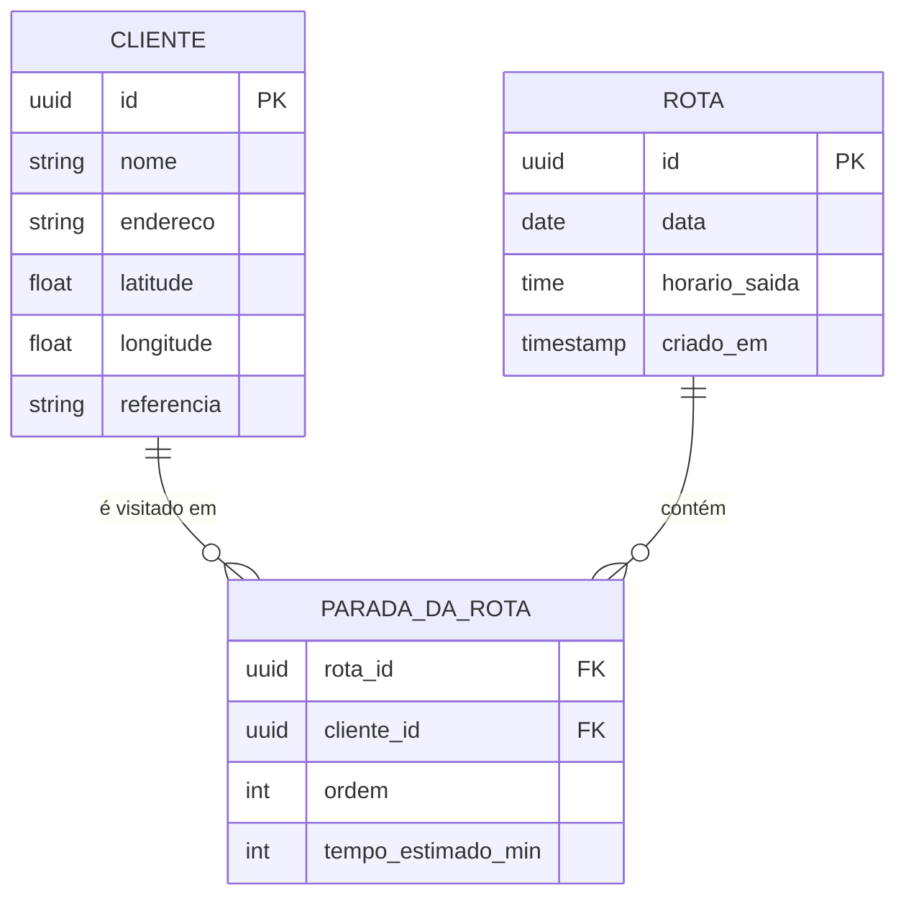
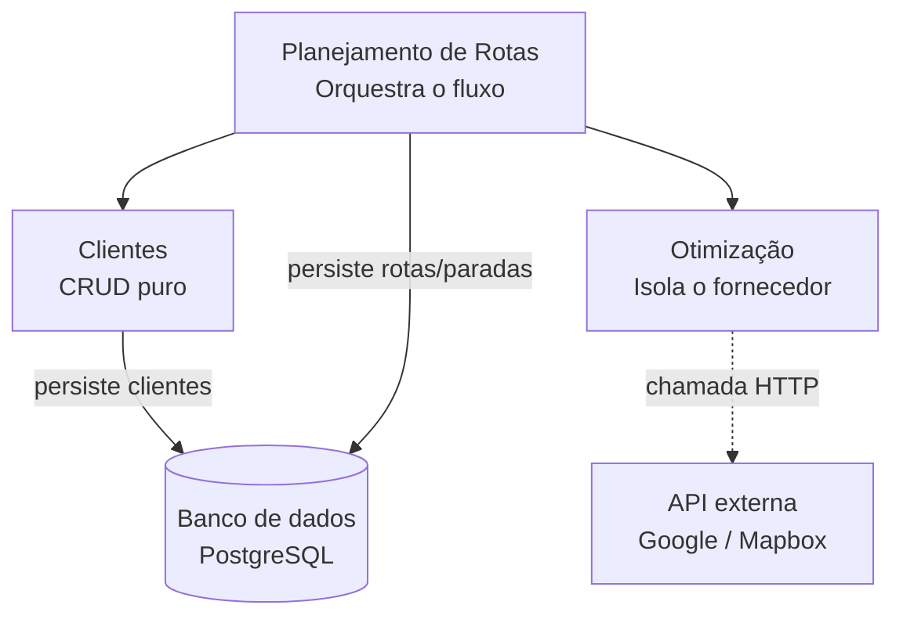
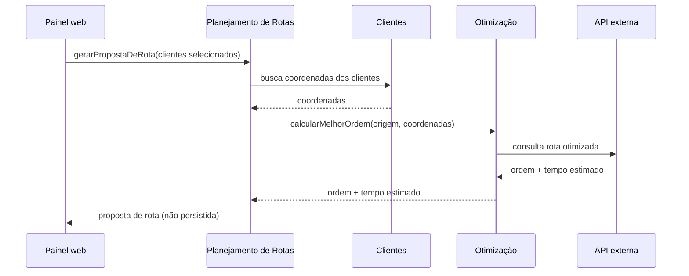

# Arquitetura — Sistema de Otimização de Rotas

## Contexto

Empresa de pequeno porte, sem setor de TI próprio, com um único motorista/veículo. Hoje a rota de entregas é montada manualmente. Este sistema automatiza a seleção de clientes do dia e a geração da ordem ótima de visita a partir da empresa.

## Requisitos

**Funcionais**
- RF01: Cadastrar/editar/remover clientes (nome, endereço, coordenadas, referência)
- RF02: Buscar/filtrar clientes por nome ou referência (ex: nome de transportadora)
- RF03: Selecionar um subconjunto de clientes para uma viagem
- RF04: Calcular a rota otimizada a partir da empresa (origem) até os clientes selecionados — ação sem persistência (ver ADR-001)
- RF05: Ajustar a seleção e recalcular quantas vezes necessário antes de confirmar
- RF06: Salvar a rota confirmada como registro de uma viagem (pode haver mais de uma viagem por dia)
- RF07: Editar uma rota já salva via novo recálculo, sobrescrevendo o registro (ver ADR-001)
- RF08: Consultar o histórico de rotas confirmadas

**Não funcionais**
- Baixo custo operacional
- Simplicidade de uso para operador não-técnico
- Disponibilidade não-crítica
- Baixo volume (dezenas de registros/dia) — descarta necessidade de microsserviços, filas de eventos ou mecanismos de resiliência avançados

## Modelo de domínio

| Entidade | Atributos-chave | Papel |
|---|---|---|
| **Cliente** | id, nome, endereço, lat/lng, referência, contato | Dado mestre, cadastrado uma vez, reutilizado em várias rotas |
| **Rota** | id, data, horário de saída, origem, criado_em | Representa uma viagem/turno de saída específico (pode haver mais de uma por dia) |
| **ParadaDaRota** | rota_id, cliente_id, ordem, tempo_estimado | A sequência otimizada de visitas dentro de uma rota (GRASP: Especialista na Informação) |

## Módulos e dependências

Três módulos internos, sem necessidade de separação em microsserviços dado o baixo volume (ver Requisitos não funcionais). A direção das dependências é sempre de dentro para fora: Planejamento depende de Clientes e Otimização, nunca o contrário.

**Clientes** — expõe `criarCliente`, `listarClientes(filtro?)`, `editarCliente`, `removerCliente`. Responsável por geocodificar o endereço ao cadastrar/editar um cliente, salvando lat/lng já prontos.

**Otimização** — expõe uma única função, `calcularMelhorOrdem(origem, listaDeClientes)`. Implementa a interface `CalculadoraDeRota` (ver ADR-002). Único módulo que conhece o fornecedor externo escolhido.

**Planejamento de Rotas** — expõe `gerarPropostaDeRota(clientesSelecionados)` (consulta, não persiste), `salvarRota(dados, rotaExistenteId?)` (persiste — cria ou sobrescreve, ver ADR-001), `listarHistorico(filtros?)`. Depende de Clientes e Otimização.

## Fluxo de leitura/consulta (ação "calcular")

Nada é gravado no banco nesse fluxo — só quando a pessoa confirma (`salvarRota`) é que a Rota e as Paradas são persistidas (ver ADR-001).

## Decisões arquiteturais (ADRs)

- [ADR-001 — Edição de rota via recálculo, sem versionamento histórico](adr/0001-edicao-de-rota-via-recalculo.md)
- [ADR-002 — Isolamento do provedor de otimização atrás de uma interface própria](adr/0002-isolamento-do-provedor-de-otimizacao.md)
- [ADR-003 — Stack técnica](adr/0003-stack-tecnica.md)

## Como manter esta documentação

Esta pasta (`/docs`) vive dentro do mesmo repositório do código, versionada junto com cada mudança. Quando uma decisão arquitetural mudar, atualize o ADR correspondente (ou crie um novo, numerado em sequência) em vez de editar o antigo silenciosamente — isso preserva o histórico de "por que mudamos de ideia". Os diagramas acima são código Mermaid, não imagens: editar o texto já atualiza o diagrama renderizado pelo GitHub/GitLab.
